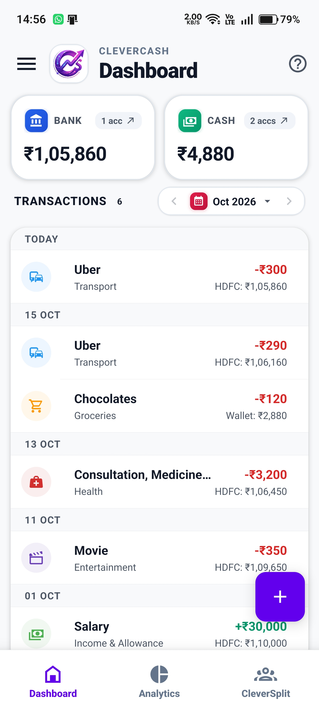
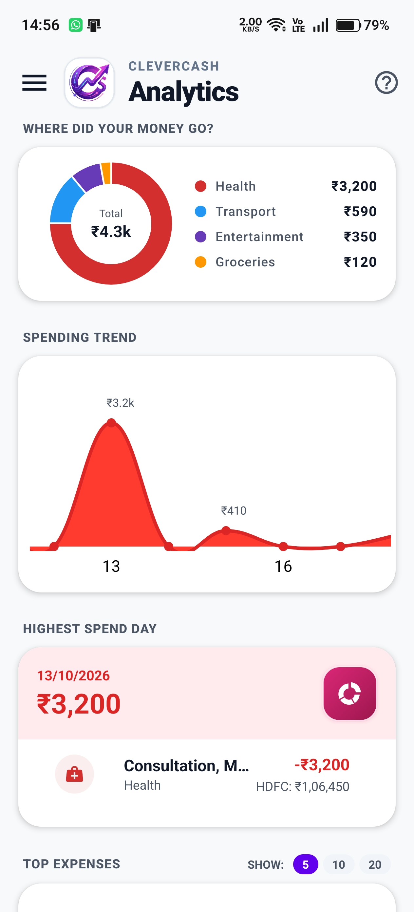
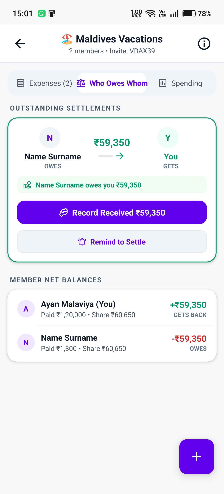
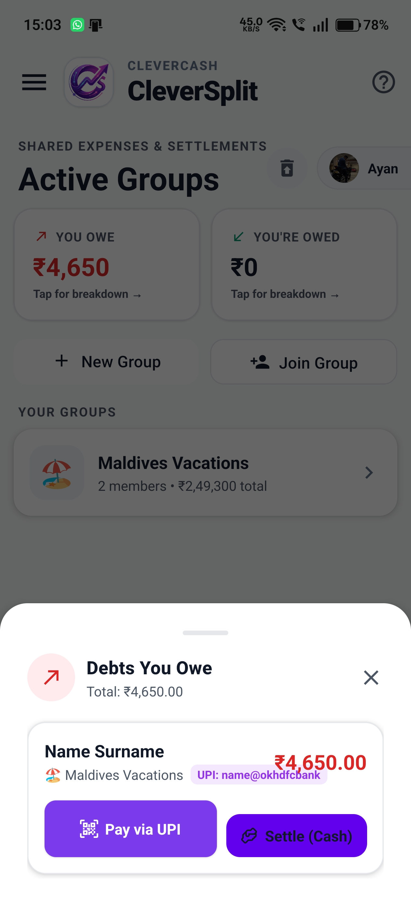
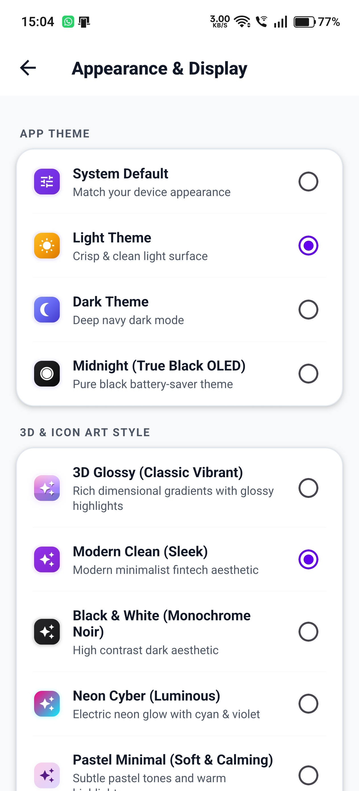
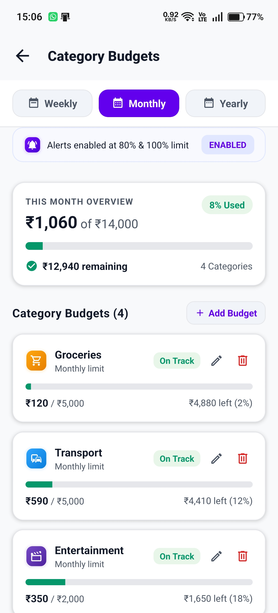

  

  # CleverCash
  ### All-in-One Personal Finance & Offline Expense Tracker with Free Group Bill Splitting

  
  
  
  
  

  **100% Free Forever • Zero Ads • No Subscriptions • 100% Private Offline Storage**

  [Official Website](https://clevercash.online) • [Launch CleverSplit PWA](https://clevercash.online/split) • [Download Android APK](https://clevercash.online/download) • [GitHub Releases](https://github.com/AyanMalaviya/clevercash.prod/releases)

---

## 💡 Why CleverCash?

Most people are forced to use **two separate apps**:
1. A **personal expense tracker** (like Money Manager or Cashew) for daily chai, groceries, rent, and monthly category budgets.
2. A **group bill splitter** (like Splitwise or Tricount) to split apartment expenses, trip bills, and dinners with friends or roommates.

**CleverCash unifies both into a single, private, ad-free experience:**

* **Personal Finance Manager:** Track multiple bank accounts, cash wallets, credit cards, monthly category budgets, and visual spending trends **100% offline** on your device.
* **CleverSplit™ (Free Splitwise Alternative):** Split shared bills with friends, roommates, and travel groups with **unlimited expenses**, **smart debt simplification**, and **mutual 2-way handshake settlement confirmation** — completely free forever with zero daily caps or paywalls.

---

## 📱 Real App Screenshots

| 1. Dashboard Overview | 2. Visual Analytics & Trends | 3. CleverSplit "Who Owes Whom" |
| :---: | :---: | :---: |
|  |  |  |

| 4. 2-Way Settlement & UPI | 5. OLED & 5 3D Icon Themes | 6. Smart Monthly Budgets |
| :---: | :---: | :---: |
|  |  |  |

---

## ✨ Core Features & Highlights

### 🔒 100% Private & Offline-First
* **No Bank Account Linking:** Never asks for net banking logins, SMS OTP read permissions, or cloud telemetry.
* **Local SQLite Storage:** All personal transactions, wallets, and budgets stay strictly on your physical device.
* **Encrypted Google Drive Backups:** Backup and restore your records privately to your personal Google Drive with version selection.

### 👥 CleverSplit™ — The Truly Free Splitwise Alternative
* **Zero Daily Limits:** Add unlimited expenses every single day with no paywalls or countdown wait timers.
* **Smart Debt Simplification:** Automatically minimizes complex group IOUs into the fewest possible payments.
* **Two-Way Verified Handshake:** When someone records a settlement, the recipient must confirm receipt with 1 tap. Debts clear only upon mutual agreement.
* **1-Tap Direct UPI Integration:** Opens Google Pay, PhonePe, Paytm, or BHIM with exact prefilled amount and payee UPI ID.
* **Cross-Platform PWA:** Friends on iPhone (Safari) and Windows can join groups, split bills, and settle debts via [clevercash.online/split](https://clevercash.online/split) with zero installation required.
* **Admin Group Controls:** Group creators can toggle permissions, manage participants, or ban disruptive members with 1-tap unban.
* **Bill Receipt Attachments:** Attach physical receipts and invoices directly to group expenses.

### 🎯 Smart Monthly Budgets & Spending Limits
* **Category Spending Caps:** Set individual limits for Dining, Groceries, Rent, Shopping, and Entertainment.
* **Proactive Alerts:** Visual progress bars warn you when crossing 80% and 100% of your allowance.
* **Days Remaining Forecast:** Calculates your safe daily spending allowance until month-end.

### 📊 Deep Visual Analytics
* **Category Donut Breakdowns:** Touch any slice to inspect exact expenditure percentages.
* **Monthly Spending Curves:** Compare month-over-month expenditure patterns effortlessly.
* **Peak Spend Day Tracker:** Pinpoints your highest spending days.

### 🎨 OLED Midnight Black & 5 3D Icon Themes
* **True OLED Pitch Black (#000000):** Conserves battery life on AMOLED displays.
* **5 App Icon Themes:** Choose between Modern Clean, Vibrant 3D, Claymorphism, Frosted Glass, and Obsidian Gold.
* **Custom Category Emojis & Images:** Assign custom accent colors and 1:1 image icons.
* **Indian Lakhs/Crores vs Western Formats:** Switch between Lakhs/Crores and Millions/Billions.

### 🛡️ Security & Convenience
* **Biometric Lock:** Secure your ledger with Fingerprint, Face ID, or PIN unlock.
* **Privacy Balance Shield:** 1-tap blur on home screen to hide net worth in public places.
* **15-Day Recycle Bin:** Safely restore accidentally deleted transactions, accounts, or groups.
* **Tax-Ready CSV & PDF Export:** Export clean spreadsheets and formatted statements anytime.

---

## 🥊 Comparison: CleverCash vs Competing Apps

| Feature | Splitwise | Money Manager / Cashew | CleverCash + CleverSplit |
| :--- | :---: | :---: | :---: |
| **Personal Expense Tracking** | ❌ None | ✅ Yes | **✅ Full Multi-Account Ledger** |
| **Category Monthly Budgets** | ❌ None | ✅ Yes | **✅ With 80% & 100% Alerts** |
| **Group Bill Splitting** | ⚠️ 3-4 exp/day limit | ❌ None | **✅ Unlimited Expenses Forever** |
| **Smart Debt Simplification** | 🔒 Paid Pro Only | ❌ None | **✅ 100% Free Included** |
| **Mutual Settlement Handshake** | ❌ One-sided | ❌ None | **✅ Verified 2-Way Confirmation** |
| **Direct UPI Payments (India)** | ❌ Manual | ❌ None | **✅ 1-Tap Launch (GPay, PhonePe)** |
| **Offline Privacy** | ❌ Cloud Required | ⚠️ Varies | **✅ 100% Offline SQLite** |
| **No Ads / Zero Paywalls** | ❌ Heavy Ads & Timers | ⚠️ In-App Purchases | **✅ Zero Ads, Zero Subscriptions** |
| **Web & iOS PWA Access** | ✅ Web App | ❌ Mobile Only | **✅ Instant PWA (No Install Needed)** |

---

## 📥 How to Install

### Android (APK)
1. Download the latest `CleverCash.v1.0.2.apk` from the [Releases Page](https://github.com/AyanMalaviya/clevercash.prod/releases/latest) or [clevercash.online/download](https://clevercash.online/download).
2. Open the file on your device and tap **Install** *(Enable "Install unknown apps" if prompted)*.
3. Future updates can be checked and installed directly from within the app Settings!

### iPhone & iPad (Safari PWA)
1. Open [clevercash.online/split](https://clevercash.online/split) in Safari.
2. Tap the **Share** button (`⎙`).
3. Select **Add to Home Screen**. CleverSplit runs with standalone app speed and offline caching.

### Windows, Mac & Linux (Desktop)
1. Open [clevercash.online/split](https://clevercash.online/split) in Google Chrome or Microsoft Edge.
2. Click the **Install** icon in the address bar to run CleverSplit as a desktop app.

---

## 🏷️ AlternativeTo Submission Details

Use these exact values when submitting or updating CleverCash on [AlternativeTo.net/software/submit/](https://alternativeto.net/software/submit/):

* **App Name:** `CleverCash`
* **Short Description (under 200 chars):** `All-in-one private personal finance manager, offline expense tracker, and free group bill splitter with zero ads.`
* **License:** **`Free`** *(Freeware / Closed Source — 100% free with no in-app purchases and no paywalls)*
* **Pricing:** `$0 / 100% Free Forever`
* **Website:** `https://clevercash.online`
* **Download URL (Android):** `https://clevercash.online/download`
* **Web App (PWA):** `https://clevercash.online/split`
* **Release / Distribution Repo:** `https://github.com/AyanMalaviya/clevercash.prod`
* **Platforms:**
  * `Android`
  * `Web / Web App (PWA)`
  * `iPhone / iPad` *(via Safari PWA)*
  * `Windows` *(via Desktop PWA)*
  * `Mac` *(via Desktop PWA)*

### 🥊 Apps to Add as Alternatives (Highest Search Traffic)
1. **Splitwise** *(Primary alternative — zero daily limits vs Splitwise's 3/day)*
2. **Money Manager Expense & Budget** *(Offline personal ledger & multi-wallet alternative)*
3. **Tricount**
4. **Splid**
5. **Cashew: Expense Manager**
6. **Settle Up**
7. **Bluecoins**

### 🏷️ Curated Tags & Feature Keywords for AlternativeTo
*(Type these directly into the AlternativeTo tag selector — these match existing popular tags on the site)*

**Core Categories:**
* `Expense Tracker`
* `Personal Finance`
* `Bill Splitting`
* `Budget Manager`
* `Money Management`
* `Debt Tracker`
* `IOU Tracker`

**Privacy & Data Ownership:**
* `Offline`
* `Works Offline`
* `No Ads`
* `No Tracking`
* `No Bank Account Required`
* `Encrypted Cloud Backup`
* `Google Drive Sync`
* `Local Storage (SQLite)`

**Features & Capabilities:**
* `Progressive Web App (PWA)`
* `UPI Payment`
* `Debt Simplification`
* `Shared Expenses`
* `Group Expenses`
* `Receipt Attachment`
* `Dark Theme`
* `OLED Dark Mode`
* `Biometric Authentication`
* `Fingerprint App Lock`
* `CSV Export`
* `PDF Export`
* `Multi-Currency`

---

## 📬 Contact & Support

CleverCash is designed and actively maintained with care by **Ayan Malaviya**.

* **Website:** [clevercash.online](https://clevercash.online)
* **Email:** [ayanmalaviya111@gmail.com](mailto:ayanmalaviya111@gmail.com)
* **Instagram:** [@ayanmalaviya](https://instagram.com/ayanmalaviya)
* **Bug Reports & Feedback:** [Submit an Issue](https://github.com/AyanMalaviya/clevercash.prod/issues)
